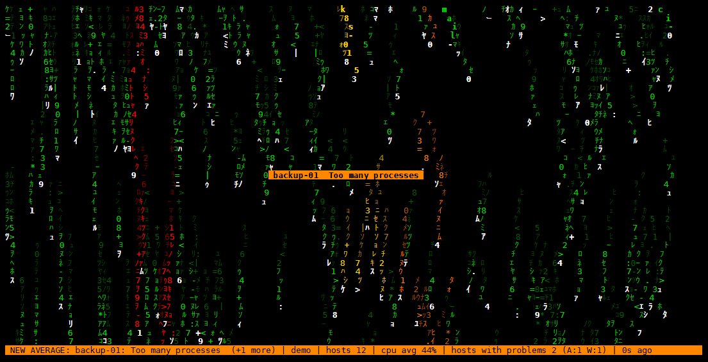

# Real Matrix

Matrix-style "digital rain" in your terminal, but not a random one: your Zabbix
draws it. The busier your hosts, the denser and faster the code falls; open
problems tint a host's band with the severity colour, and a new problem shakes
the whole screen.



## What it is for

Real Matrix turns the state of your infrastructure into a screensaver. Keep it on
a second monitor, a server room screen or in a corner of your desktop and read
the situation at a glance, even from across the room:

* calm green rain: all is quiet;
* one band pouring dense and fast: that host is working hard right now;
* coloured bands: those hosts have open problems, the colour tells how bad;
* a full-screen glitch: something new has just happened, the host and the
  problem text appear in the centre and in the status line.

It is a decoration, not a replacement for alerting: notifications, on-call and
problem handling stay in Zabbix. Real Matrix changes nothing in Zabbix and never
acknowledges problems.

## How the data becomes rain

Every host owns a band of screen columns.

| Zabbix data | Effect |
|---|---|
| CPU utilisation, % (`system.cpu.util`) | how many streams fall in the band and how fast |
| Interface traffic (`net.if.in[...]`, `net.if.out[...]`) | stream length |
| Open problems | part of the band takes the colour of the host's worst problem (see [Colours](#colours)) |
| A new problem | the screen glitches, the host and problem flash in the centre and stay in the status line for 30 seconds |
| Now and then | a stream "decodes" and spells the host name, CPU load and problem count |

Problems already open at start-up show only as tinted bands: the glitch and the
banner fire for problems raised while the rain is running. Press `t` to see
what that looks like (see [Test problems](#test-problems)).

Hosts without fresh CPU data (e.g. network devices without such an item) stay
on screen, their band just falls slowly.

## Colours

The rain itself:

| Colour | Meaning |
|---|---|
| white, bold | the leading glyph of every stream |
| bright green fading to dark green | an ordinary stream: the host has no open problems |
| white letters | a host name being spelled, with CPU load and `!N` open problems |

Zabbix problem severities. A host with problems gets part of its band in the
colour of its worst problem: 55% of the streams for one problem, 10% more for
every further one, up to 95%. Its spelled name takes the same colour.

| Colour | Severity | Status line letter |
|---|---|---|
| yellow | Warning | `W` |
| orange (bold yellow on 8-colour terminals) | Average | `A` |
| red | High | `H` |
| magenta | Disaster | `D` |
| blue | Information, shown only with `--min-severity 1` or lower | `I` |
| grey | Not classified, shown only with `--min-severity 0` | `N` |

When a new problem appears, the screen flickers for about half a second with
inverted glyphs in its severity colour, a banner with the host and the problem
text stays in the centre for 4 seconds, and the status line turns that colour
for 30 seconds.

The status line is green normally and red with `NO CARRIER` when Zabbix cannot
be reached. It shows the source and Zabbix version, the number of hosts, the
average CPU load, the number of hosts with problems by severity, for example
`(H:1 A:1 W:2)`, and how long ago the data was fetched.

## How it works

It is a single Python file with two independent parts.

**Polling Zabbix.** A background thread calls the Zabbix API every 30 seconds
(`--interval`) with an API token, using read-only methods only:

1. `host.get`: the monitored hosts (or only those of the chosen groups, `--group`);
2. `item.get`: the latest values of CPU utilisation and interface traffic. Only
   the last value is read, no history is queried. Several CPUs of a host are
   averaged, several interfaces are summed;
3. `trigger.get`: triggers in the problem state at or above the chosen severity
   (`--min-severity`, warning by default).

A problem counts as new when its trigger was not in the previous poll. Values
older than 15 minutes (`--stale`) and items that were never collected count as
missing rather than zero. One poll is three or four light requests, so the load
on the Zabbix server is negligible.

**Drawing.** The main thread draws 20 frames per second with the standard
`curses` module and never waits for Zabbix. When new data arrives it recomputes
each band: how often and how fast streams fall (CPU), how long they are
(traffic), what colour they take (problems). If Zabbix stops answering, the rain
goes on with the last data and the status line shows `NO CARRIER` with the
reason. The program itself uses about 3-4% of one CPU core.

## Requirements

* Linux or macOS, a UTF-8 terminal with 256 colours (almost any will do);
* Python 3.8+, nothing else: standard library only;
* Zabbix 5.4+ with an API token (tested on 7.0).

On Windows run it in WSL.

## Quick start

```bash
git clone https://github.com/rozenpl/real-matrix.git
cd real-matrix
python3 real_matrix.py --demo
```

`--demo` shows simulated hosts and needs no Zabbix. Quit with `q` or `Esc`.

## Connecting to Zabbix

### 1. A read-only user

All it needs is a user that can see the hosts. In Zabbix 6.0+ (in 6.x the menu
items live under "Administration"):

1. **Users → User groups → Create**: e.g. `matrix-readonly`; on the "Host
   permissions" tab grant **Read** on the host groups you want to see.
2. **Users → Users → Create**: e.g. `matrix`, member of that group, role
   **User role**. Any long password will do, it is never used.
3. Optionally narrow the API: make your own role from User role and in "API
   methods" allow only `host.get`, `hostgroup.get`, `item.get`, `trigger.get`.
4. **Users → API tokens → Create API token** for this user. Copy the token:
   Zabbix shows it only once.

### 2. Put the token into a file

```bash
mkdir -p ~/.config
install -m 600 /dev/null ~/.config/real-matrix.token
nano ~/.config/real-matrix.token
```

The token is deliberately not accepted on the command line, where other users
of the machine could see it with `ps`.

### 3. Check and run

```bash
export ZABBIX_URL=https://zabbix.example.com
export ZABBIX_TOKEN_FILE=~/.config/real-matrix.token
python3 real_matrix.py --check
```

`--check` polls Zabbix once and prints a table of hosts, CPU, traffic and
problems. If it looks right:

```bash
python3 real_matrix.py
```

Certificate from a private CA: `--ca-file /path/to/ca.pem`. Self-signed:
`--insecure` (internal networks only).

## Controls

| Key | Action |
|---|---|
| `q`, `Esc` | quit |
| `t` | show a test problem (see below) |
| `n` | spell every host name right now |
| `l` | turn host names in the streams off and on |
| `h` | hide or show the status line |
| space | pause and resume |

The window may be resized at any time, the picture adapts. With
`--screensaver` any key quits, which suits a screensaver.

## Test problems

Real problems are rare (hopefully), so there are two ways to see what one
looks like.

**Key `t`.** Picks a random host on the screen and shows a fake problem for it:
the glitch, the banner `TEST problem (local only, not in Zabbix)`, the message
in the status line and the tinted band for about 30 seconds. Every press raises
the severity: warning, average, high, disaster, then warning again. It happens
only on your screen: nothing is sent to Zabbix, nobody gets notified.

**Demo mode.** `python3 real_matrix.py --demo` runs twelve simulated hosts
(`--demo-hosts N` for another number). Their load wanders and bursts, problems
of random severity appear and resolve on their own every several seconds, so the
whole show plays without any Zabbix server.

## Options

| Option | Environment | Meaning |
|---|---|---|
| `--url` | `ZABBIX_URL` | Zabbix frontend URL |
| `--token-file` | `ZABBIX_TOKEN_FILE` | file with the API token (or the token itself in `ZABBIX_TOKEN`) |
| `--group NAME` | `ZABBIX_GROUPS` (comma separated) | only hosts of these groups; repeatable |
| `--min-severity N` | | ignore problems below N (0..5, default 2 = warning) |
| `--interval S` | | seconds between polls (default 30) |
| `--insecure`, `--ca-file` | `ZABBIX_INSECURE=1`, `ZABBIX_CA_FILE` | certificate checks |
| `--cpu-key`, `--net-key` | | item key regexes, if your templates differ |
| `--stale S` | | values older than this count as missing (default 900) |
| `--anonymize` | | show `host-01`, `host-02`... and hide problem texts: for screenshots and streams |
| `--charset` | | `katakana`, `ascii`, `binary`, `hex` |
| `--spacing 2` | | use every second column: airier, closer to the film |
| `--fps` | | frames per second (default 20) |
| `--label-every S` | | average seconds between a host spelling its name (default 30) |
| `--no-labels`, `--no-hud` | | no host names, no status line |
| `--screensaver` | | quit on any key |
| `--transparent` | | keep the terminal background instead of black |
| `--demo`, `--demo-hosts N` | | simulated hosts |
| `--check` | | poll once, print a table, exit |

Full list: `python3 real_matrix.py --help`.

## Troubleshooting

* **Boxes instead of glyphs.** The terminal font has no half-width katakana:
  use `--charset ascii` or install a CJK font (e.g. Noto Sans Mono CJK).
* **`NO CARRIER` in the status line.** Zabbix is unreachable or rejected the
  token; the text after the colon says why. The rain goes on with the last data.
* **Every band falls slowly.** Your templates do not collect `system.cpu.util`.
  Look at `--check` and pass a `--cpu-key` regex matching an item that holds CPU
  utilisation in percent.
* **Certificate verification fails.** `--ca-file` or `--insecure`.

## Tests

```bash
python3 -m unittest discover -s tests -v
```

The tests replace the Zabbix API with canned answers and use no network.

## License

MIT, see [LICENSE](LICENSE).
