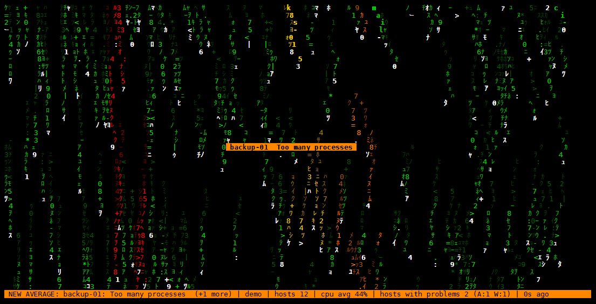

# zabbix-matrix-rain

[English](README.md)

«Цифровой дождь» в терминале, как на мониторах операторов из фильма «Матрица», но
живой: его рисует ваш Zabbix. Чем сильнее нагружены узлы, тем гуще и быстрее
льётся код; проблемы окрашивают полосу узла в цвет серьёзности, новая проблема
встряхивает весь экран.



Практической пользы немного, зато красиво: на втором мониторе, на экране в
серверной или как заставка в tmux.

## Как данные превращаются в картинку

Каждый узел получает свою полосу столбцов экрана.

| Данные Zabbix | Что меняется |
|---|---|
| Загрузка CPU, % (`system.cpu.util`) | сколько потоков падает в полосе и как быстро |
| Трафик интерфейсов (`net.if.in[...]`, `net.if.out[...]`) | длина потоков |
| Открытые проблемы | часть потоков полосы окрашена в цвет худшей проблемы: жёлтый (предупреждение), оранжевый (средняя), красный (высокая), пурпурный (чрезвычайная) |
| Новая проблема | экран на мгновение вспыхивает, в центре появляется имя узла и текст проблемы, в строке состояния он держится 30 секунд |
| Время от времени | один поток «расшифровывается» и выписывает имя узла, загрузку и число проблем |

Проблемы, открытые на момент запуска, видны только цветом полос: вспышка и баннер
срабатывают на проблему, которая появилась уже во время работы. Посмотреть, как
это выглядит, можно клавишей `t`.

Узлы без свежих данных CPU (например, сетевые устройства без такого элемента)
остаются в картинке, но их полоса течёт медленно.

## Что нужно

* Linux или macOS, терминал с UTF-8 и 256 цветами (подойдёт почти любой);
* Python 3.8 или новее, больше ничего: только стандартная библиотека;
* Zabbix 5.4 или новее с API-токеном (проверено на 7.0).

На Windows запускайте в WSL.

## Быстрый старт

```bash
git clone https://github.com/rozenpl/zabbix-matrix-rain.git
cd zabbix-matrix-rain
python3 zabbix_matrix_rain.py --demo
```

Режим `--demo` показывает вымышленные узлы, Zabbix для него не нужен.
Выход: `q` или `Esc`.

## Подключение к Zabbix

### 1. Пользователь только для чтения

Достаточно пользователя, который видит нужные узлы. В Zabbix 6.0 и новее
(в 6.x пункты лежат в меню «Администрирование»):

1. **Пользователи → Группы пользователей → Создать**: группа, например
   `matrix-readonly`; на вкладке «Права доступа к узлам сети» дайте право
   **Чтение** на группы узлов, которые хотите видеть.
2. **Пользователи → Пользователи → Создать**: пользователь, например `matrix`,
   в группе из шага 1, роль **User role**. Пароль задайте любой длинный: он не
   понадобится.
3. По желанию сузьте API: создайте свою роль на основе User role и в разделе
   «Методы API» разрешите только `host.get`, `hostgroup.get`, `item.get`,
   `trigger.get`.
4. **Пользователи → API-токены → Создать API-токен** для этого пользователя.
   Скопируйте токен: Zabbix покажет его только один раз.

### 2. Токен в файл

```bash
mkdir -p ~/.config
install -m 600 /dev/null ~/.config/zabbix-matrix-rain.token
nano ~/.config/zabbix-matrix-rain.token
```

Вставьте токен, сохраните. В командной строке токен не принимается намеренно:
там его видят другие пользователи машины через `ps`.

### 3. Проверка и запуск

```bash
export ZABBIX_URL=https://zabbix.example.com
export ZABBIX_TOKEN_FILE=~/.config/zabbix-matrix-rain.token
python3 zabbix_matrix_rain.py --check
```

`--check` один раз опрашивает Zabbix и печатает таблицу: узлы, загрузку, трафик,
проблемы. Если таблица заполнена, запускайте:

```bash
python3 zabbix_matrix_rain.py
```

Сертификат Zabbix выпущен своим центром сертификации: `--ca-file /путь/к/ca.pem`.
Самоподписанный сертификат: `--insecure` (только во внутренней сети).

## Клавиши

| Клавиша | Действие |
|---|---|
| `q`, `Esc` | выход |
| `h` | показать или скрыть строку состояния |
| `l` | включить или выключить имена узлов в потоках |
| `n` | выписать имена всех узлов прямо сейчас |
| `t` | тестовая проблема: вспышка, баннер и подкраска полосы случайного узла; при каждом нажатии серьёзность растёт от предупреждения до чрезвычайной. В Zabbix ничего не отправляется |
| пробел | пауза |

## Параметры

| Параметр | Переменная окружения | Назначение |
|---|---|---|
| `--url` | `ZABBIX_URL` | адрес веб-интерфейса Zabbix |
| `--token-file` | `ZABBIX_TOKEN_FILE` | файл с API-токеном (или сам токен в `ZABBIX_TOKEN`) |
| `--group ИМЯ` | `ZABBIX_GROUPS` (через запятую) | только узлы этих групп; можно повторять |
| `--min-severity N` | | не учитывать проблемы ниже N (0..5, по умолчанию 2, предупреждение) |
| `--interval С` | | секунд между опросами (по умолчанию 30) |
| `--insecure`, `--ca-file` | `ZABBIX_INSECURE=1`, `ZABBIX_CA_FILE` | проверка сертификата |
| `--cpu-key`, `--net-key` | | регулярные выражения ключей элементов, если у вас другие шаблоны |
| `--stale С` | | значения старше этого считаются отсутствующими (по умолчанию 900) |
| `--anonymize` | | показывать `host-01`, `host-02` вместо имён и скрыть тексты проблем: для снимков экрана и трансляций |
| `--charset` | | `katakana`, `ascii`, `binary`, `hex` |
| `--spacing 2` | | заполнять каждый второй столбец: воздушнее, ближе к фильму |
| `--fps` | | кадров в секунду (по умолчанию 20) |
| `--label-every С` | | как часто в среднем узел выписывает своё имя (по умолчанию 30 с) |
| `--no-labels`, `--no-hud` | | без имён узлов, без строки состояния |
| `--screensaver` | | выход по любой клавише |
| `--transparent` | | фон терминала вместо чёрного |
| `--demo`, `--demo-hosts N` | | вымышленные узлы |
| `--check` | | опросить один раз и вывести таблицу |

Полный список: `python3 zabbix_matrix_rain.py --help`.

## Если что-то не так

* **Вместо символов квадраты.** В шрифте терминала нет полуширинной катаканы:
  `--charset ascii` или установите шрифт с CJK (например, Noto Sans Mono CJK).
* **`NO CARRIER` в строке состояния.** Zabbix недоступен или отверг токен; текст
  после двоеточия называет причину. Дождь продолжает идти на последних данных.
* **Все полосы текут медленно.** Шаблоны ваших узлов не собирают
  `system.cpu.util`. Посмотрите `--check` и задайте в `--cpu-key` регулярное
  выражение ключа, значение которого означает загрузку CPU в процентах.
* **Сертификат не проходит проверку.** `--ca-file` или `--insecure`.

## Проверки

```bash
python3 -m unittest discover -s tests -v
```

Тесты подменяют API Zabbix заготовленными ответами и сеть не используют.

## Лицензия

MIT, см. [LICENSE](LICENSE).
